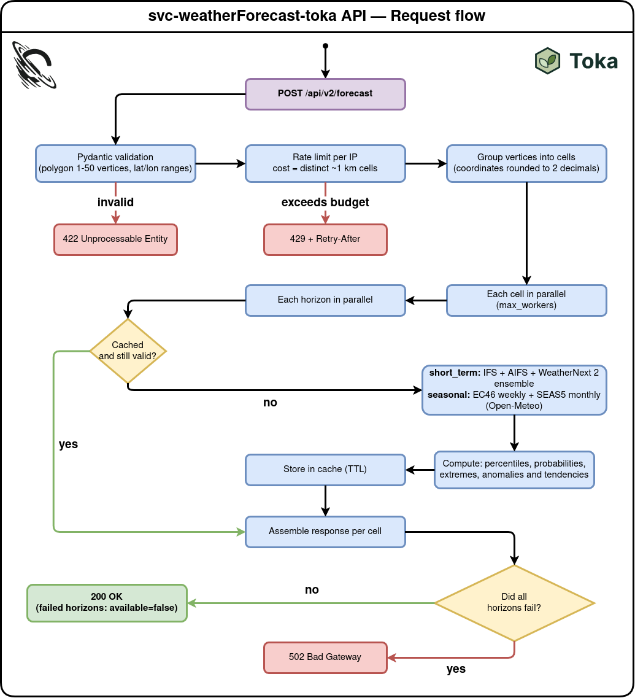
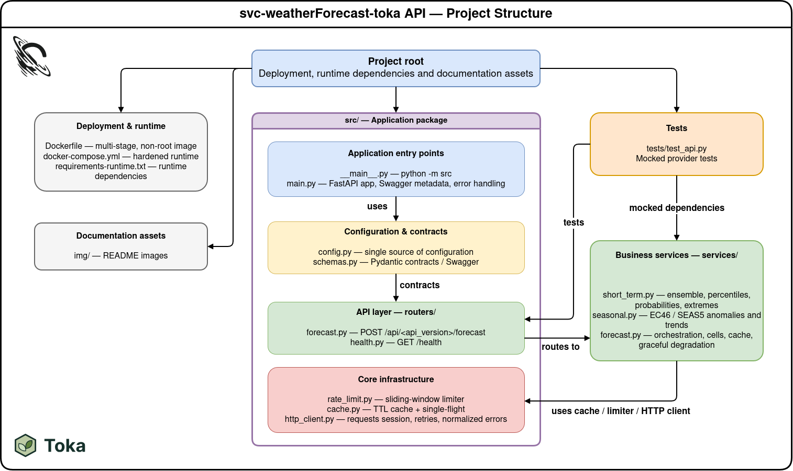

# svc-weatherForecast-toka


**Future-climate** service of the Toka architecture. The environmental data unifier calls it to build a field's environmental context: it receives a parcel polygon and returns a **short-term forecast** and a **seasonal outlook**, always with metadata and uncertainty.

> It contains no agronomic logic: it only delivers environmental evidence. Historical climate (normals, trends) is served by `svc-weatherHistory-toka`, not by this service.

## Table of contents

1. [What this service does](#what-this-service-does)
2. [Models used](#models-used)
3. [Request flow](#request-flow)
4. [Installation and running](#installation-and-running)
5. [Configuration (`src/config.py`)](#configuration-srcconfigpy)
6. [Swagger and API documentation](#swagger-and-api-documentation)
7. [Usage example](#usage-example)
8. [Tests](#tests)
9. [Project structure](#project-structure)
10. [Known limitations](#known-limitations)
11. [How to contribute](#how-to-contribute)
12. [License](#license)

---

## What this service does

It receives a polygon (1 to 50 vertices, WGS84) and returns the requested horizons for each ~1 km cell it covers:

| Horizon | `type` | Source | Delivers |
|---|---|---|---|
| `short_term` | `forecast` | ECMWF IFS/AIFS + Google WeatherNext 2 ensembles (Open-Meteo Ensemble API), up to 15 days | Median, P10-P90 band, rain probability, frost / heat / heavy-rain probability, accumulated rain |
| `seasonal` | `outlook` | ECMWF EC46 (weekly) + SEAS5 (monthly), Open-Meteo Seasonal API | Ensemble-mean anomaly + tendency, **low confidence** |

A multi-day forecast is **not** a seasonal projection: the two horizons are never merged. This service does not consume NASA data.

Key features:

- The vertices of a parcel are grouped into **~1 km cells** to avoid repeating data and requests.
- **In-memory cache** with TTL (1 h short term, 6 h seasonal) and *single-flight* (simultaneous requests for the same cell trigger a single provider call).
- **Graceful degradation**: if one horizon fails, it responds with `available: false` and the other one is delivered normally.
- **Rate limiting** per client IP with `X-RateLimit-*` headers.
- All configuration lives in a single file: `src/config.py`.

## Models used

**Short term (pooled ensemble)**

| Model | Identifier | Members |
|---|---|---|
| ECMWF IFS | `ecmwf_ifs025` | 51 |
| ECMWF AIFS | `ecmwf_aifs025` | 51 |
| Google WeatherNext 2 | `google_weathernext2` | 64 |

The members of the three models are pooled into a single ensemble (51 + 51 + 64 = 166). The **median (P50)** is the central value, the band is **P10-P90**, and each probability is the percentage of members that meet the threshold on that day.

**Seasonal**

| Scale | Model | Range |
|---|---|---|
| Weekly | ECMWF EC46 | ~46 days |
| Monthly | ECMWF SEAS5 | ~7 months |

Open-Meteo delivers these values already averaged over the ensemble, so the service reports **anomaly** and **tendency** (`colder|normal|warmer`, `drier|normal|wetter`). A tendency is **not a probability**, and the anomaly is relative to the model's own climatology, not to that of `svc-weatherHistory-toka`.

## Request flow



Description:

1. **Validation**: FastAPI + Pydantic validate the body (`422` if invalid).
2. **Rate limit**: 1 unit is charged per distinct cell (a parcel normally costs 1). If exceeded, `429` with `Retry-After`.
3. **Cells**: vertices are grouped by cell; `cells[].vertices` indicates which (1-based) vertices each result covers.
4. **Parallel computation**: cells and horizons are computed in parallel, with a TTL cache in between.
5. **Provider**: Open-Meteo is queried (with retries and normalized errors). If one ensemble model does not respond, the rest are used and a `warning` is added.
6. **Response**: `200` even if one horizon fails (`available: false` + `error`); `502` only if **all** horizons fail in all cells.

## Installation and running

### Requirements

- Python 3.12 (to run without Docker)
- Docker (optional)

### With Python

```bash
# 1. Virtual environment and dependencies (once)
python -m venv .venv
source .venv/bin/activate          # Windows: .venv\Scripts\activate
pip install -r requirements-runtime.txt

# 2. Run (host and port come from src/config.py)
python -m src
```

Alternative with an explicit port (ignores `port` from `config.py`):

```bash
uvicorn src.main:app --host 0.0.0.0 --port 5000
```

There is no `.env` file: nothing to create before running.

### With Docker

```bash
docker build -t svc-weatherforecast-toka .

# host 5000 -> container 5000
docker run -d --name weatherforecast -p 5000:5000 svc-weatherforecast-toka

# host 8080 -> container 5000
docker run -d --name weatherforecast -p 8080:5000 svc-weatherforecast-toka

# commercial Open-Meteo use: pass the key as an environment variable
docker run -d -p 5000:5000 -e OPEN_METEO_API_KEY=your_key svc-weatherforecast-toka

# view logs
docker logs -f weatherforecast
```

### With Docker Compose (recommended)

The `docker-compose.yml` includes hardening: read-only filesystem, no capabilities, no privilege escalation, process and memory limits, and the port exposed only on `127.0.0.1`.

```bash
export OPEN_METEO_API_KEY=your_key   # optional, commercial use only
docker compose up -d --build
```

> If you change `port` in `config.py`, also update `EXPOSE` in the `Dockerfile` and the container side of `-p` / `ports`.

### Check that it works

```bash
curl localhost:5000/health
```

It returns the status, the active port, the service version and the API version.

## Configuration (`src/config.py`)

`src/config.py` is the **single source of configuration**. Edit the default values of the `Settings` class and **restart** the service: routes, Swagger, `/health`, the Docker healthcheck and the tests all read from it.

```python
# src/config.py (excerpt)
service_version: str = "3.1.0"   # shown in Swagger and in every response
api_version: str = "v2"          # endpoints under /api/v2/...  -> with "v3" they move to /api/v3/...
port: int = 5000
```

The only value that is **not** in the file is the Open-Meteo key (it is a secret): set it with the `OPEN_METEO_API_KEY` environment variable so it never lands in git. It is only needed for **commercial** use; Open-Meteo is free for non-commercial use only.

| Setting | Default | Description |
|---|---|---|
| `service_name` | `svc-weatherForecast-toka` | Service name (Swagger title and responses) |
| `service_version` | `3.1.0` | Service version |
| `api_version` | `v2` | URL version; must look like `v1`, `v2`… (validated at startup) |
| `host` | `0.0.0.0` | Bind address |
| `port` | `5000` | Service port |
| `ensemble_models` | `ecmwf_ifs025`, `ecmwf_aifs025`, `google_weathernext2` | Models in the short-term ensemble |
| `short_term_days` | `15` | Short-term horizon length in days |
| `rain_threshold_mm` | `1.0` | A member "rains" when daily precipitation ≥ this value |
| `heavy_rain_mm` | `20` | Heavy-rain threshold |
| `frost_c` | `0` | Frost when the minimum ≤ this value |
| `heat_c` | `35` | Heat when the maximum ≥ this value |
| `seasonal_weekly_days` / `seasonal_monthly_days` | `46` / `210` | EC46 / SEAS5 request length |
| `temp_normal_band_c` | `0.5` | Temperature band considered "normal" |
| `precip_normal_band_pct` | `20` | Precipitation band considered "normal" |
| `precip_min_climatology` | `0.5` | Below this climatology the precipitation % is withheld (dry season) |
| `seasonal_confidence` | `low` | Confidence label of the seasonal horizon |
| `ttl_short_term_s` / `ttl_seasonal_s` | `3600` / `21600` | Cache lifetime (s) |
| `cache_decimals` | `2` | Coordinate rounding (0.01° ≈ 1.1 km = one cell) |
| `http_timeout_s` | `30` | Timeout per provider call |
| `max_workers` | `4` | Cells computed in parallel |
| `max_upstream_concurrency` | `8` | Simultaneous provider calls |
| `rate_limit_enabled` | `True` | Turns the limiter on/off |
| `rate_limit_units` / `rate_limit_window_s` | `120` / `60` | Budget per client per window |
| `trust_proxy_headers` | `False` | Use the first `X-Forwarded-For` hop as the client IP (only behind a trusted proxy) |
| `rate_limit_exempt_ips` | `()` | IPs that are never limited, e.g. `("10.0.0.5",)` for the data unifier |

### Changing the API version

1. Edit `api_version` in `src/config.py` (e.g. `"v3"`).
2. Restart. The endpoint becomes `POST /api/v3/forecast` and `/api/v2/forecast` no longer exists.
3. Run the tests: they build their URLs from the config, so they pass unchanged.

## Swagger and API documentation

With the service running, open in your browser:

| Documentation | URL |
|---|---|
| **Swagger UI** (interactive) | <http://localhost:5000/docs> |
| ReDoc | <http://localhost:5000/redoc> |
| OpenAPI schema (JSON) | <http://localhost:5000/openapi.json> |

The root (`http://localhost:5000/`) automatically redirects to `/docs`.

To try an endpoint from Swagger:

1. Open `/docs` and expand **POST `/api/v2/forecast`**.
2. Click **Try it out** and edit the example JSON with your polygon.
3. Click **Execute** and review the response, the status code and the `X-RateLimit-*` headers.

> If you use Docker with a different host port (for example `-p 8080:5000`), change the port in the URL: `http://localhost:8080/docs`.

## Usage example

```bash
curl -X POST localhost:5000/api/v2/forecast -H 'Content-Type: application/json' -d '{
  "polygon": [
    {"lat": 20.9215, "lon": -101.4230},
    {"lat": 20.9230, "lon": -101.4210},
    {"lat": 20.9205, "lon": -101.4195},
    {"lat": 20.9195, "lon": -101.4220}
  ],
  "horizons": ["short_term", "seasonal"]
}'
```

| Field | Type | Notes |
|---|---|---|
| `polygon` | list of `{lat, lon}` | 1–50 vertices, WGS84 decimal degrees. `lat` ∈ [-90, 90], `lon` ∈ [-180, 180]. Use 1 vertex for a point |
| `horizons` | list | Optional. `short_term`, `seasonal` or both (default: both) |

**Status codes**

| Code | Meaning |
|---|---|
| 200 | OK. An individual horizon may still come back with `available: false` |
| 422 | Invalid payload (empty polygon, out-of-range coordinates, unknown horizon…) |
| 429 | Rate limit exceeded. See `Retry-After` |
| 502 | **All** requested horizons failed in all cells |

Probabilities (`rain_probability_pct`, `extremes.*`) and bands (`p10`/`p50`/`p90`) are computed over the ensemble members. Each horizon includes `metadata` (provider, CRS, resolution, units, quality), `valid_from` / `valid_to` and `generated_utc`. `warnings` report partial degradation (for example, a model that did not respond). The full schema is in Swagger.

## Tests

```bash
pip install pytest httpx
python -m pytest -q tests        # expected: 15 passed
python -m pytest -v tests        # per-test detail
```

The tests do **not** use the internet: providers are simulated (the seasonal fake reproduces the real single-series behavior). They validate logic, contracts, cache, rate limiting and the central configuration (versioned routes, `/health`, validation), **not** live provider data.

For a live check, run the service, call `POST /api/v2/forecast` with your parcel and review the `warnings` of each horizon.

## Project structure



Module Responsibilities

| File / Module | Description |
|---|---|
| `Dockerfile` | Multi-stage container image build with a non-root runtime user. |
| `docker-compose.yml` | Hardened container deployment and service configuration. |
| `requirements-runtime.txt` | Runtime dependencies. |
| `img/` | Images and visual assets used in project documentation. |
| `src/__main__.py` | Application entry point for running the package using `python -m src`. |
| `src/main.py` | FastAPI application initialization, Swagger metadata, middleware, and exception handling. |
| `src/config.py` | Centralized configuration and single source of truth for application settings. |
| `src/schemas.py` | Pydantic request and response schemas defining API contracts and Swagger documentation. |
| `src/rate_limit.py` | IP-based rate limiting using a sliding-window algorithm. |
| `src/cache.py` | TTL-based caching with single-flight request deduplication. |
| `src/http_client.py` | HTTP client session, retries, timeout handling, and normalized errors. |
| `src/services/short_term.py` | Short-term forecast processing, ensemble integration, percentiles, probabilities, and extreme weather indicators. |
| `src/services/seasonal.py` | Seasonal forecast processing, anomalies, and trend calculations using EC46 and SEAS5. |
| `src/services/forecast.py` | Forecast orchestration, spatial cell processing, caching, parallel execution, and graceful degradation. |
| `src/routers/forecast.py` | Forecast API endpoint: `POST /api/v2/forecast`. |
| `src/routers/health.py` | Health-check endpoint: `GET /health`. |
| `tests/test_api.py` | API tests using mocked external weather providers. |

### Architecture Overview

The application follows a modular architecture separating API routing, business logic, infrastructure, and configuration.

- **API Layer:** Handles incoming requests, validation, and HTTP responses.
- **Services Layer:** Implements forecast processing and orchestration logic.
- **Infrastructure:** Provides caching, rate limiting, and HTTP communication.
- **Configuration:** Centralizes application settings.
- **Testing:** Validates API behavior using mocked external dependencies.

## Known limitations

- Seasonal precipitation is assumed to be in mm/day (`precip_min_climatology` depends on it); not yet confirmed with raw provider values.
- Weekly EC46 probabilities are not implemented (value scale unverified).
- There are no long-term scenarios (CMIP6).
- Cache and rate limit are **in memory**: they are lost on restart and not shared between replicas.
- Seasonal categories use fixed bands, not *hindcast* terciles.
- Data is raw model output with no local bias correction; spatial resolution is native (~25 km short term, ~36 km seasonal).
- Open-Meteo is free for **non-commercial** use only.

## How to contribute

Contributions are welcome! Follow these steps:

1. **Fork** the repository and clone it:
   ```bash
   git clone https://github.com/Singularity-MX/svc-weatherForecast-toka
   cd api
   ```
2. **Create a descriptive branch** from the main one:
   ```bash
   git checkout -b feat/name-of-the-improvement      # or fix/name-of-the-fix
   ```
3. **Set up the environment** (see [With Python](#with-python)) and install the test dependencies:
   ```bash
   pip install -r requirements-runtime.txt pytest httpx
   ```
4. **Make your changes**, following the project rules:
   - All configuration goes in `src/config.py`; do not add `.env` files or hard-coded values scattered through the code.
   - Secrets are only read from environment variables and are never written to the repository.
   - The service contains **no** agronomic logic and does not mix horizons (`forecast` vs `outlook`).
   - If you change the API contract, update `src/schemas.py` (Swagger is generated from it).
5. **Add or update tests** in `tests/test_api.py`. They must work without internet (simulated providers).
6. **Run the tests** and confirm everything passes:
   ```bash
   python -m pytest -q tests
   ```
7. **Update the documentation**: this README and, if applicable, `service_version` in `src/config.py`.
8. **Commit** with clear messages ([Conventional Commits](https://www.conventionalcommits.org/) are suggested, e.g. `feat: add hail threshold`) and push your branch:
   ```bash
   git push origin feat/name-of-the-improvement
   ```
9. **Open a Pull Request** describing what changes, why, and how to test it.

To report bugs or propose ideas, open an *issue* with the steps to reproduce, the expected result and the actual result (include the `warnings` or `error` from the response, if any).

## License

Distributed under the **GNU GPL v3** license. See the [LICENSE](./LICENSE) file for details.

## Developed by Singularity

[Web](https://singularitymx.org)
[Instagram](https://instagram.com/singularity.open)


```text
  
.%@@@@*:
%@@@@@@@@@%.
%@@@.    .=%@#.
-@@@.         #@+     -
 %@@%            #%.   .%=
  @@@#     :%%=    :%=    ##.
   %@@%    %@@%%%#    **    *@+
    %@@%   *@@.   :%-   :.     =*#%@@@@@@@@%##+.
    .%@@@. .%@%      *.  .+@@@@@@@@@@@@@@@@@@@@@@@@*:
     .@@@@-  @@%      -%@@@@@@@@@@@@@@@@@@@@@@@@@@@@@@%+
       %@@@=  -@:   *@@@@@@@@@@@@@@@@@@@@@@@@@@@@@@@@@@@@%:
        %@@@*     -@@@@@@@@@@@@@@@%##+=----=#%@@@@@@@@@@@@@@-
         #@@@%   -@@@@@@@@@@@%:                  -@@@@@@@@@@@%.
          =@@@@.  %@@@@@@@#                         -%@@@@@@@@@*
   *       :@@@@=  #@@@@=                             .@@@@@@@@@%
   =@.  @*   %@@@#  :@@@-  .                            *@@@@@@@@%
    -@=  %@+  %@@@@.  *@@%  *.                           =@@@@@@@@#
     -@#  %@@# #@@@@#  .@@@* :%                           -@@@@@@@@*
      .@%  +@@@@@@@@@@.  =@@@- ##                          +@@@@@@@@
        @@- .%@@@@@@@@@+   #@@@+=@+                         %@@@@@@@*
         %@*  *@@@@@@@@@%    %@@@@@@=                       :@@@@@@@%
       -  %@%:  #@@@@@@@@@#   -@@@@@@%:                      +@@@@@@%
      .@@- *@@#  -@@@@  *@@@-   *@@@@@@@.                      .::.
       .@@% :@@@:  =@@%   +@@%:   #@@@@@@#
         %@@: #@@*   *@@+   +@@%   .%@@@@@@#
          %@@# .@@@:   #@@:   *@@%   .@@@@@@@=
          -@@@@##@@@%    *@%.   #@@+   -@@@@@@@:
           +@@@@@@@@@@=    +%*    #@@+   =@@@@@@*
            #@@@@@@@@@@%:           #@@-   =@@@@@-
         =-  #@@@@@@@@@@@%            *@%.   +@@@*  :
          -@: +@@@@@@@@@@@@%            .:     *@@+ -@%          .+
            #%  %@@@@@@@@@@@@%-                  +@@. +@%:        :%.
             :@# =@@@@@@@@@@@@@@@@@@@@%:     %*    .+:  #@%:   #=   @#
               #@* -@@@@@@%  +@@@@@@@@@@@+    *@@+        #@@-  *%   #@:
                 #@+ .#@@@@%   :@@@@@@@@@@@%:   *@@#        +@@%#@@:  =@+
                  :%@:   *@@@+   .%@@@@@@@@@@@#.  *@@%:       .#@@@@   -@%
                +   -@%.    #@@+    #@@@@@@@@@@#    =@@@=         -%:   :@%
                 %*   =@#     =@@*    =@@+            .%@@#.             -@@.
                  +@+   =@#      %@%.   .%@%             +%@@#            %@%
                    %@+   :%=      +@%=    +@@+             +@@@#.        +@@=
                      #@+             *@*     *@@+             =%@@@*:.  =@@@%
                        #@%              +%                        #@@@@@@@@@#
                          :%#                                          :+#%#-
 ```
